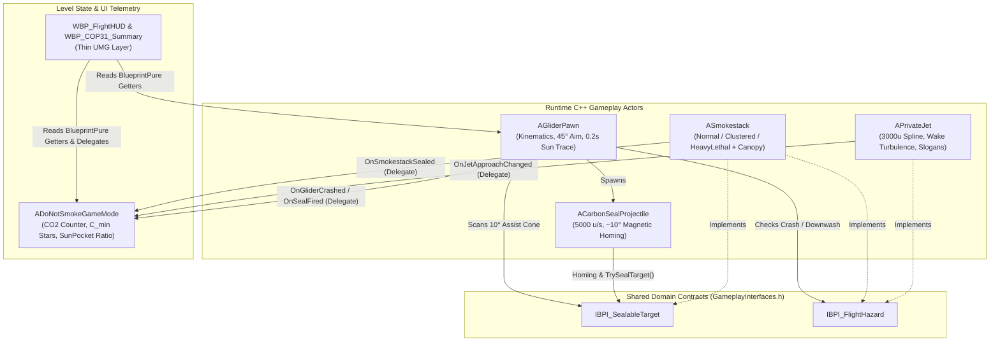

# DO NOT SMOKE — AI-First Technical Architecture & Handover Spec

> [!IMPORTANT]
> **AI AGENT HANDOVER DIRECTIVE:** This document is the single authoritative technical architecture and session-recovery blueprint for **Do Not Smoke** (UE 5.8, C++ Core + Thin Blueprint Layer). Any AI model or new chat session resuming work on this project must read this file first to understand the class graph, SOLID boundaries, data flow, and current implementation state before writing code.

---

## 1. Architectural Philosophy & HFS-SOLID Rules

1. **AI-First C++ Core + Thin Blueprint Layer:**
   - All flight kinematics, vector math, 45° cone clamping, ~10° magnetic homing, collision state machines, and COP31 carbon scoring reside in deterministic UE5 C++ (`Source/DoNotSmoke/`).
   - Blueprints (`Content/Game/`) are strictly thin visual/data wrappers (`BP_GliderPawn`, `BP_CarbonSeal`, `BP_Smokestack`, `BP_PrivateJet`, `BP_DoNotSmokeGameMode`) used by Quark, Berf (UI/Audio), and Barlas (3D/VFX) to assign meshes, Niagara systems, Sound Cues, and UMG widgets.
2. **Strict SOLID & Zero Concrete Downcasting:**
   - **No God-Actor Coupling:** Peer actors (`AGliderPawn`, `ACarbonSealProjectile`, `ASmokestack`, `APrivateJet`) **never** `#include` or `Cast<T>` to each other.
   - **ISP / LSP via `GameplayInterfaces.h`:** All cross-actor interactions occur exclusively through `IBPI_SealableTarget` and `IBPI_FlightHazard`.
   - **DIP via Dynamic Multicast Delegates:** Level progression, smokestack sealing, crash restarts, and HUD alerts communicate via `DECLARE_DYNAMIC_MULTICAST_DELEGATE` and `BlueprintImplementableEvent` hooks (`BP_On...`).
3. **Step-by-Step HFS-SOLID Execution:**
   - Present/verify `.h` contracts before `.cpp` bodies, work in small modular increments (1–2 classes per turn), and pause for Quark's checkpoint confirmation.

---

## 2. System Dependency Graph & Decoupled Communication



---

## 3. Complete C++ Module & Class Inventory (`Source/DoNotSmoke/`)

The entire game is strictly bounded to **6 C++ units** (1 interface header + 5 gameplay classes). Never spawn redundant helper classes or micro-components outside this inventory:

### 3.1 `GameplayInterfaces.h` (Shared Domain Interfaces)
* **`UBPI_SealableTarget` / `IBPI_SealableTarget`:**
  * `bool TrySealTarget(AActor* SealInstigator)`: Transitions target (or the specific hit mouth on a Clustered stack) from Open to Sealed.
  * `bool IsTargetSealed() const`: Queries seal state.
  * `FVector GetTargetRimLocation() const`: Returns world-space primary open rim center.
  * `TArray<FVector> GetUnsealedRimLocations() const`: Returns world-space centers of all currently unsealed chimney mouths on the actor (`1` for Single/Heavy, `2–3` for Clustered) for per-mouth `~10°` magnetic homing.
* **`UBPI_FlightHazard` / `IBPI_FlightHazard`:**
  * `bool IsLethalCrashHazard(const UPrimitiveComponent* HazardComponent) const`: Returns `true` for physical chimney bodies and active Type C lethal smoke pillars.
  * `float GetWakeDownwashSpeed(const UPrimitiveComponent* HazardComponent) const`: Returns downward velocity penalty (`u/s`) when overlapping a non-lethal wake turbulence volume (`0.f` otherwise).

### 3.2 `ASmokestack` (`Smokestack.h` / `Smokestack.cpp`)
* **Role:** Unified industrial chimney actor implementing `IBPI_SealableTarget` and `IBPI_FlightHazard`.
* **Archetypes (`ESmokestackType`):**
  * `Normal` (Type A): Single chimney (`SM_Smokestack_Single`), non-lethal smoke.
  * `Clustered` (Type B): Side-by-side power plant chimneys (`SM_Smokestack_Cluster`); 5.0s launcher cooldown forces banking turnaround loops.
  * `HeavyLethal` (Type C): High-pressure chimney (`SM_Smokestack_Heavy`) with an active vertical `LethalPlumeCapsule` (`NS_HeavyToxicSmog`). Flying inside causes an immediate Crash; requires angled side flyby (`45°` cone).
* **Sun Pocket & Smog Canopy Mechanism:**
  * Each `ASmokestack` owns an overhead `OverheadSmogCanopySphere` positioned at canopy altitude (`Z = 2700u` world or relative top) that blocks `ECC_Visibility` upward sunlight traces while unsealed and expands as level carbon rises.
  * When `TrySealTarget()` succeeds:
    1. `bIsSealed = true`
    2. `RimTargetSphere`, `LethalPlumeCapsule`, and `OverheadSmogCanopySphere` disable collision (`NoCollision`), immediately opening a **Sun Pocket (God-Ray)** above the chimney.
    3. `ToxicSmogVFX` deactivates, `CleanSteamVFX` activates.
    4. Broadcasts `OnSmokestackSealed` to `ADoNotSmokeGameMode` and fires `BP_OnSmokestackSealed()`.

### 3.3 `ACarbonSealProjectile` (`CarbonSealProjectile.h` / `CarbonSealProjectile.cpp`)
* **Role:** Eco-capsule launched by `AGliderPawn` at `5000 u/s` (`ProjectileGravityScale = 0.25f`).
* **Subtle Magnetic Homing (`~10°`):**
  * `InitializeLaunch(LaunchDirection, HomingTargetActor)` receives the pre-clamped launch vector and optional `IBPI_SealableTarget` actor found within the `10°` aim-assist cone.
  * In `Tick`, gently interpolates velocity direction (`VInterpNormalRotationTo`) toward `IBPI_SealableTarget::Execute_GetTargetRimLocation`.
  * On overlapping a non-hazard component of an `IBPI_SealableTarget`, calls `Execute_TrySealTarget()`, fires `BP_OnSealImpact(Location, true)`, and destroys itself.

### 3.4 `AGliderPawn` (`GliderPawn.h` / `GliderPawn.cpp`)
* **Role:** Player-controlled Solar Glider pawn (`BP_GliderPawn` parent).
* **Subsystems (Internal Clean Methods):**
  1. **Zero-Setup Input (`SetupPlayerInputComponent`):** Binds `W/S` (Pitch), `A/D` (Roll/Yaw), `Mouse X/Y` (Decoupled Look), `Space/LeftShift` (Solar Boost), and `LMB` (Fire Carbon Seal) directly in C++ so any map works immediately without manual Input Action asset setup.
  2. **Kinematic Flight & Strict Net-Loss Energy (`UpdateFlightKinematics`):**
     * Speed bounds: `BaseVelocity = 1800 u/s`, `MaxDiveVelocity = 3800 u/s`, `StallVelocity = 900 u/s` (auto-pitches nose down on stall).
     * Glide Ratio (`15:1`) & `MaxAllowedGlideZ`: Diving increases kinetic speed and pitching up trades speed back for altitude, but when not Solar Boosting, `ActorLocation.Z` is hard-clamped by `MaxAllowedGlideZ`, which steadily decays with horizontal distance (`DeltaXY / 15.0f`).
     * **Solar Boost:** Drains `SolarCharge` at `25%/s`, adds `+2200 u/s` thrust along `GetActorForwardVector()`, and raises `MaxAllowedGlideZ` up to `GliderMaxCeilingAltitude` (`2600u`).
  3. **Altitude Stack & 0.2s Sunlight Trace (`UpdateSolarEnergyAndAltitudeChecks`):**
     * `Z <= 200u` (**Kill Floor**): Immediate Crash -> `OnGliderCrashed` -> Instant Restart.
     * `Z < 400u` (**Smog Bed**): Blocks sunlight charge (`bIsInSunlight = false`).
     * `Z < 600u` (**Pull-Up Warning**): Toggles `bIsPullUpWarningActive` and broadcasts `OnPullUpWarningChanged`.
     * Every `0.2s` (`PerformSunlightTrace`): Fires a vertical `LineTraceSingleByChannel` from glider up to `Z = 3500u` (`ECC_Visibility`). If `Z >= 400u` and unblocked by overhead `SmogCanopy`, charges battery at `+12.5%/s`; otherwise `0%/s`.
  4. **Decoupled Camera & 45° Clamped Aiming (`UpdateDecoupledCamera` & `FireCarbonSeal`):**
     * `CameraBoom` rotates independently via `CameraYawOffset` (`[-110°, +110°]`) and `CameraPitchOffset` (`[-60°, +45°]`). FOV interpolates between `90°` and `110°`.
     * `ComputeClampedAimDirection`: Takes camera look vector, clamps angle to `45°` cone around `GetActorForwardVector()`, and scans open `IBPI_SealableTarget` rims within `10°` of the aim ray (up to `8000u`) to pass into `ACarbonSealProjectile::InitializeLaunch`. Enforces `5.0s` reload cooldown.

### 3.5 `APrivateJet` (`PrivateJet.h` / `PrivateJet.cpp` — Milestone 2)
* **Role:** Stratospheric VIP polluter (`3000u` altitude) implementing `IBPI_FlightHazard`.
* **Mechanics:**
  * Moves along a `USplineComponent` at `Z = 3000u` (above glider's `2600u` ceiling, preventing direct pawn-to-jet mesh collisions).
  * Trails a `WakeTurbulenceBox` (`UBoxComponent`) extending downward into the glider's flight band (`1800u–2600u`). When `AGliderPawn` overlaps it, `IBPI_FlightHazard::GetWakeDownwashSpeed` applies downward altitude loss and camera shake (`BP_OnWakeTurbulenceHit`).
  * Displays a trailing `SM_JetBanner` mesh / widget cycling through the 4 satirical slogans (*"ON MY WAY TO CLIMATE SUMMIT!"*, *"DON'T FORGET YOUR PAPER STRAW!"*, *"THOUGHTS & PRAYERS FOR THE PLANET"*, *"NET-ZERO BY 2099!"*).
  * Broadcasts `OnJetApproachStateChanged(bool bApproaching, FText ActiveSlogan)` to trigger the HUD top-center red `!` alert and `SFX_Jet_Roar`.

### 3.6 `ADoNotSmokeGameMode` (`DoNotSmokeGameMode.h` / `DoNotSmokeGameMode.cpp`)
* **Role:** Sector state machine, cumulative carbon accountant, and UI telemetry hub.
* **Mechanics:**
  * In `BeginPlay`, registers all `ASmokestack` actors (`OnSmokestackSealed`), `APrivateJet` actors (`OnJetApproachStateChanged`), and the player `AGliderPawn` (`OnGliderCrashed`, `OnCarbonSealFired`).
  * Accumulates `CumulativeCarbonKg += OpenSmokestackCount * 10.0f * DeltaTime`.
  * Updates `SunPocketOpenRatio` (`1.0 -> 0.0`) based on `CumulativeCarbonKg / (TargetMinCarbonKg * SkyChokeCarbonMultiplier)` and updates active smokestack overhead canopies.
  * Evaluates 1–3 Stars against `TargetMinCarbonKg` ($C_{\min}$: `500 kg` L1, `1200 kg` L2, `2200 kg` L3):
    * **3 Stars:** $\le 1.25 \times C_{\min}$
    * **2 Stars:** $\le 1.75 \times C_{\min}$
    * **1 Star:** $> 1.75 \times C_{\min}$
  * When `OpenSmokestackCount == 0`, broadcasts `OnLevelCompleted` and `BP_OnLevelCompleted` to display `WBP_COP31_Summary` with dynamic newspaper headline (`GetNewspaperHeadlineForStars`).

---

## 4. Content Folder Structure & Blueprint Binding Contract

```text
Content/Game/
├── Core/       -> BP_DoNotSmokeGameMode
├── Player/     -> BP_GliderPawn (Parent: AGliderPawn), BP_CarbonSeal (Parent: ACarbonSealProjectile)
├── Actors/     -> BP_Smokestack_Single, BP_Smokestack_Cluster, BP_Smokestack_Heavy (Parent: ASmokestack)
│               -> BP_PrivateJet (Parent: APrivateJet)
├── Maps/       -> L_Level01_Valley (80/20/0, C_min=500)
│               -> L_Level02_Corridor (40/50/10 + 600u low stacks + Jet, C_min=1200)
│               -> L_Level03_Basin (20/30/50 + Heavy Plume walls + Jet, C_min=2200)
├── UI/         -> WBP_FlightHUD, WBP_COP31_Summary, WBP_MainMenu
├── Audio/      -> Sound Cues (Wind, Boost, Latch, Jet Roar, PullUp Alarm)
├── VFX/        -> NS_ToxicSmog, NS_HeavyToxicSmog, NS_CleanSteam, NS_JetWake, NS_Sunbeam
└── Meshes/     -> SK_SolarGlider, SM_Smokestack_*, SM_PrivateJet, SM_JetBanner, SM_City_Blockout
```

---

## 5. Implementation Roadmap & Current Session State

* **[DONE] Step 1:** Scaffolded `DoNotSmoke.uproject`, `DoNotSmoke.Build.cs`, `Target.cs`, `DoNotSmoke.h/.cpp`, and approved headers `GameplayInterfaces.h`, `Smokestack.h`, `CarbonSealProjectile.h`.
* **[DONE] Step 2:** Implemented `Smokestack.cpp` & `CarbonSealProjectile.cpp`; authored headers `GliderPawn.h` & `DoNotSmokeGameMode.h`.
* **[DONE] Step 3 (Milestone 1 Completion):** Added `OverheadSmogCanopySphere` to `ASmokestack`, implemented `GliderPawn.cpp` and `DoNotSmokeGameMode.cpp`, and verified `DoNotSmokeEditor` compilation (`libUnrealEditor-DoNotSmoke.so`, 0 errors).
* **[DONE] Step 4 (Milestone 2 — Private Jet, Greybox Visuals & Debug HUD):** Authored `PrivateJet.h` & `PrivateJet.cpp` (`3000u` spline flight, `WakeTurbulenceBox`, 4 satirical banner slogans, `UTextRenderComponent` 3D banner), wired `OnPrivateJetAlertChanged` into `ADoNotSmokeGameMode`, added `/Engine/BasicShapes/` greybox fallbacks + live on-screen debug HUD (`bShowDebugHUD`), set `GlobalDefaultGameMode`, and compiled `libUnrealEditor-DoNotSmoke.so` with 0 errors.
* **[NEXT] Step 5 (In-Engine Playtest & Milestone 3 Thin Blueprint Wrappers):**
  1. Launch Unreal Editor and playtest flight feel, 45° clamped aiming, ~10° magnetic homing, smokestack sealing, and private jet wake turbulence.
  2. Create thin Blueprint child classes under `Content/Game/` and wire `WBP_FlightHUD` / `WBP_COP31_Summary`.
