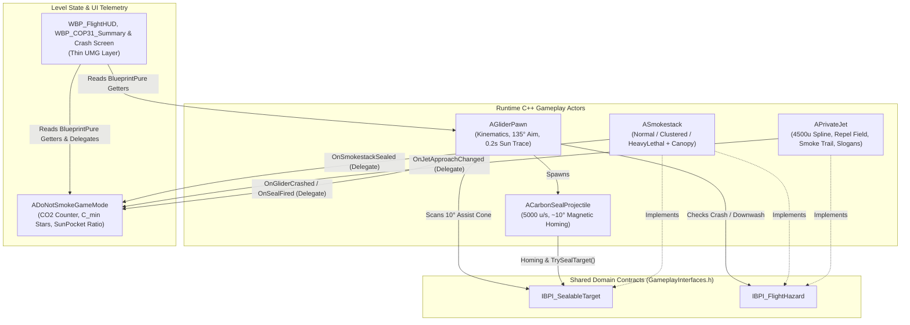

# DO NOT SMOKE — AI-First Technical Architecture & Handover Spec

> [!IMPORTANT]
> **AI AGENT HANDOVER DIRECTIVE:** This document is the single authoritative technical architecture and session-recovery blueprint for **Do Not Smoke** (UE 5.8, C++ Core + Thin Blueprint Layer). Any AI model or new chat session resuming work on this project must read this file first to understand the class graph, SOLID boundaries, data flow, and current implementation state before writing code.

---

## 1. Architectural Philosophy & HFS-SOLID Rules

1. **AI-First C++ Core + Thin Blueprint Layer:**
   - All flight kinematics, vector math, 135° cone clamping, ~10° magnetic homing, collision state machines, and COP31 carbon scoring reside in deterministic UE5 C++ (`Source/DoNotSmoke/`).
   - Blueprints (`Content/Game/`) are strictly thin visual/data wrappers (`BP_GliderPawn`, `BP_CarbonSeal`, `BP_Smokestack`, `BP_PrivateJet`, `BP_DoNotSmokeGameMode`) used by Quark, Berf (UI/Audio), and Barlas (3D/VFX) to assign meshes, Niagara systems, Sound Cues, and UMG widgets.
2. **Strict SOLID & Zero Concrete Downcasting:**
   - **No God-Actor Coupling:** Peer actors (`AGliderPawn`, `ACarbonSealProjectile`, `ASmokestack`, `APrivateJet`) **never** `#include` or `Cast<T>` to each other.
   - **ISP / LSP via `GameplayInterfaces.h`:** All cross-actor interactions occur exclusively through `IBPI_SealableTarget` and `IBPI_FlightHazard`.
   - **DIP via Dynamic Multicast Delegates:** Level progression, smokestack sealing, crash restarts, and HUD alerts communicate via `DECLARE_DYNAMIC_MULTICAST_DELEGATE` and `BlueprintImplementableEvent` hooks (`BP_On...`).
3. **Step-by-Step HFS-SOLID Execution:**
   - Present/verify `.h` contracts before `.cpp` bodies, work in small modular increments (1–2 classes per turn), and pause for Quark's checkpoint confirmation.

---

## 2. System Dependency Graph & Decoupled Communication



---

## 3. Complete C++ Module & Class Inventory (`Source/DoNotSmoke/`)

The entire game is strictly bounded to **6 C++ units** (1 interface header + 5 gameplay classes). Never spawn redundant helper classes or micro-components outside this inventory:

### 3.1 `GameplayInterfaces.h` (Shared Domain Interfaces)
* **`UBPI_SealableTarget` / `IBPI_SealableTarget`:**
  * `bool TrySealTarget(AActor* SealInstigator)`: Transitions target (or the specific hit mouth on a Clustered stack) from Open to Sealed.
  * `bool IsTargetSealed() const`: Queries seal state.
  * `FVector GetTargetRimLocation() const`: Returns world-space primary open rim center.
  * `TArray<FVector> GetUnsealedRimLocations() const`: Returns world-space centers of all currently unsealed chimney mouths on the actor (`1` for Single/Heavy, `2–3` for Clustered) for per-mouth `~10°` magnetic homing.
* **`UBPI_FlightHazard` / `IBPI_FlightHazard`:**
  * `bool IsLethalCrashHazard(const UPrimitiveComponent* HazardComponent) const`: Returns `true` for physical chimney bodies and active Type C lethal smoke pillars.
  * `float GetWakeDownwashSpeed(const UPrimitiveComponent* HazardComponent) const`: Returns downward velocity penalty (`u/s`) when overlapping a non-lethal wake turbulence volume (`0.f` otherwise).

### 3.2 `ASmokestack` (`Smokestack.h` / `Smokestack.cpp`)
* **Role:** Unified industrial chimney actor implementing `IBPI_SealableTarget` and `IBPI_FlightHazard`.
* **Archetypes (`ESmokestackType`):**
  * `Normal` (Type A): Single chimney (`SM_Smokestack_Single`), non-lethal smoke.
  * **Height scaling:** each archetype's art mouth height is multiplied by `NormalHeightScale` (2.0) / `ClusteredHeightScale` (1.0) / `HeavyHeightScale` (1.714, same ~2400u as Type A) and the per-instance `HeightVariation` (0.5–2.0); the body mesh is stretched in Z and rims, collision and VFX follow the scaled mouth height.
  * `Clustered` (Type B): Side-by-side power plant chimneys (`SM_Smokestack_Cluster`); 5.0s launcher cooldown forces banking turnaround loops.
  * `HeavyLethal` (Type C): High-pressure chimney (`SM_Smokestack_Heavy`) with an active vertical `LethalPlumeCapsule` (`NS_HeavyToxicSmog`). Flying inside causes an immediate Crash; requires angled side flyby (`135°` cone).
* **Sun Pocket & Smog Canopy Mechanism:**
  * Each `ASmokestack` owns an overhead `OverheadSmogCanopySphere` positioned at canopy altitude (`Z = 8500u` world; radius `1500u` → `9000u`) that blocks `ECC_Visibility` upward sunlight traces while unsealed and expands as level carbon rises. A child `CanopySmokeVFX` (`NS_SkySmog`, `CanopySmokeOffsetZ` +1200u, i.e. ~9700u, above the 8500u gameplay disc so big sprites do not hang into the flight band) is driven every tick through user parameters `SpreadRadius` (= canopy radius, cylinder spawn shape) `SpawnRate` (`CanopySmokeSpawnRateRange` 3 → 16/s) and `SizeScale` (`CanopySmokeSizeScaleRange` 1 → 2, multiplies the 1200–2000 sprite size); it is deactivated when the stack is fully sealed so the cloud dissipates.
  * `ADoNotSmokeGameMode::ApplySkyChoke(ChokeAlpha)` only dims the first `ADirectionalLight` to `ChokedSunIntensityScale` (0.6); no haze is ever added to the play space (the height fog second layer stays at 0). Level completion resets it.
  * **Canopy as a disc:** `OverheadSmogCanopySphere` is the bottom cap of a sphere lifted `CanopyDomeLift` (200,000u) above `CanopyWorldAltitude`; its radius is `sqrt(R^2 + Lift^2)`, so at Z 8500 its cross-section is exactly the cloud radius R and it never sags into the flight band. Every sunlight query therefore ends at Z 8500 (`AGliderPawn::SunlightTraceTopZ`), never higher.
  * **Sun rain:** `ADoNotSmokeGameMode::BuildSunRainGrid` covers the smokestacks' bounding box (+`SunRainMargin` 12 km) with `SunRainCellSize` (5 km) cells, each an `NS_SunMotes` component at Z 8000 (a copy of `NS_SkySmog` driven through its user params: `SpreadRadius` 3000, `SunRainSpawnRate` 1.6, `SunRainSizeScale` 0.15; colour (8, 5.6, 0.9) HDR yellow, rotation 0, additive `M_LightStreak` that draws a thin vertical line inside each sprite, falling under gravity). Every `SunRainCheckInterval` (0.5 s) each cell traces 3000u → 8500u and deactivates while a canopy covers it.
  * Debug: `DebugSealNearestStack` (non-shipping exec) fully seals the stack nearest the glider.
  * Smoke VFX: `NS_ToxicSmog` (dark grey, Normal/Clustered), `NS_HeavyToxicSmog` (pitch black, dense, Type C via `GetActiveSmogSystem`), `NS_SealSparkle` (warm yellow glints on a sealed rim, a copy of `NS_SunMotes` with no gravity, a slight upward drift and the default additive sprite material; it stands in for the solar panel glint). All use the translucent unlit `M_SmokeSprite` (particle colour RGB + alpha times a soft radial noise mask); the default Niagara sprite material is additive and cannot draw dark smoke.
  * When `TrySealTarget()` succeeds:
    1. `bIsSealed = true`
    2. `RimTargetSphere`, `LethalPlumeCapsule`, and `OverheadSmogCanopySphere` disable collision (`NoCollision`), immediately opening a **Sun Pocket (God-Ray)** above the chimney.
    3. `ToxicSmogVFX` deactivates, `SealSparkleVFX` activates and `SFX_Seal_Latch` plays at the rim (a Type C stack also fades out its `HeavyRumbleAudio`).
    4. Broadcasts `OnSmokestackSealed` to `ADoNotSmokeGameMode` and fires `BP_OnSmokestackSealed()`.

### 3.3 `ACarbonSealProjectile` (`CarbonSealProjectile.h` / `CarbonSealProjectile.cpp`)
* **Role:** Eco-capsule launched by `AGliderPawn` at `5000 u/s` (`ProjectileGravityScale = 0.25f`).
* **Subtle Magnetic Homing (`~10°`):**
  * `InitializeLaunch(LaunchDirection, HomingTargetActor)` receives the pre-clamped launch vector and optional `IBPI_SealableTarget` actor found within the `10°` aim-assist cone.
  * In `Tick`, gently interpolates velocity direction (`VInterpNormalRotationTo`) toward `IBPI_SealableTarget::Execute_GetTargetRimLocation`.
  * On overlapping a non-hazard component of an `IBPI_SealableTarget`, calls `Execute_TrySealTarget()`, fires `BP_OnSealImpact(Location, true)`, and destroys itself.

### 3.4 `AGliderPawn` (`GliderPawn.h` / `GliderPawn.cpp`)
* **Role:** Player-controlled Solar Glider pawn (`BP_GliderPawn` parent).
* **Subsystems (Internal Clean Methods):**
  1. **Zero-Setup Input (`SetupPlayerInputComponent`):** Binds `W/S` (Pitch), `A/D` (Roll/Yaw), `Mouse X/Y` (Decoupled Look), `Space/LeftShift` (Solar Boost), and `LMB` (Fire Carbon Seal) directly in C++ so any map works immediately without manual Input Action asset setup.
  2. **Kinematic Flight & Strict Net-Loss Energy (`UpdateFlightKinematics`):**
     * Speed bounds: `BaseVelocity = 2400 u/s`, `MaxDiveVelocity = 4600 u/s`, `StallVelocity = 900 u/s` (auto-pitches nose down on stall).
     * Glide Ratio (`GlideRatio = 20`) & `MaxAllowedGlideZ`: When not Solar Boosting the glider sinks at `CurrentSpeed / GlideRatio` at every attitude (~120 u/s at base speed). Diving increases kinetic speed and pitching up trades speed back for altitude, but `ActorLocation.Z` is hard-clamped by `MaxAllowedGlideZ`, which decays at the same ratio (`DeltaXY / GlideRatio`), so a zoom climb can never out-climb the sink.
     * **Solar Boost:** Drains `SolarCharge` at `25%/s`, adds `+2200 u/s` thrust along `GetActorForwardVector()`, and raises `MaxAllowedGlideZ` up to `GliderMaxCeilingAltitude` (`7800u`).
  3. **Altitude Stack & 0.2s Sunlight Trace (`UpdateSolarEnergyAndAltitudeChecks`):**
     * `Z <= 200u` (**Kill Floor**): Immediate Crash (`EGliderCrashCause::Ground`) -> `OnGliderCrashed` -> crash screen.
     * `Z < 400u` (**Smog Bed**): Blocks sunlight charge (`bIsInSunlight = false`).
     * `Z < 1200u` (**Pull-Up Warning**): Toggles `bIsPullUpWarningActive`, loops `SFX_PullUp_Alarm` and broadcasts `OnPullUpWarningChanged`.
     * Every `0.2s` (`PerformSunlightTrace`): Fires a vertical `LineTraceSingleByChannel` from the glider `SunlightTraceLength` (`10000u`) straight up (`ECC_Visibility`). If `Z >= 400u` and unblocked by overhead `SmogCanopy`, charges battery at `+12.5%/s`; otherwise `0%/s`.
  4. **Decoupled Camera & 135° Clamped Aiming (`UpdateDecoupledCamera` & `FireCarbonSeal`):**
     * `CameraBoom` rotates independently via `CameraYawOffset` (`[-85°, +85°]`) and `CameraPitchOffset` (`[-60°, +45°]`). FOV interpolates between `90°` and `96°`.
     * `ComputeClampedAimDirection`: Takes camera look vector, clamps angle to a `135°` half-angle cone around `GetActorForwardVector()` (only a `45°` rear cone is blocked), and scans open `IBPI_SealableTarget` rims within `10°` of the aim ray (up to `AimAssistMaxRange` = `12000u`) to pass into `ACarbonSealProjectile::InitializeLaunch`. Enforces `5.0s` reload cooldown.

### 3.5 `APrivateJet` (`PrivateJet.h` / `PrivateJet.cpp` — Milestone 2)
* **Role:** VIP polluter crossing the middle of the flight band (`JetAltitude` 4500u, forced in `BeginPlay`) implementing `IBPI_FlightHazard` (its downwash now always returns 0).
  * **Dispatch:** `ADoNotSmokeGameMode::TickJetDispatcher` turns off every jet's own timer (`SetAutoSchedulePasses(false)`) and every `JetDispatchIntervalSeconds` (10 s, first after `FirstJetDelaySeconds` 6 s) calls `RequestFlybyPass()` on one random idle route; if a pass is still in the air it retries every second, so only one jet flies at a time.
* **Mechanics:**
  * Moves along a `USplineComponent` at `Z = 4500u`. `GetRepelSphere` gives the glider a keep-out field: pushed outwards at up to `JetRepelPushSpeed` (4500 u/s) inside `RepelSoftRadius` (6500u), never closer than `RepelHardRadius` (3500u). The towed banner is a thin 5500x350u cube with mirrored `TextRenderComponent`s (220u, yellow) so the slogan reads from both sides.
  * Smoke trail (`UpdateSmokeTrail`): inside the play area (`SetSmokeArea`, set by the GameMode from the border cubes + wall margin) it drops an `NS_SkySmog` puff every `SmokePuffSpacing` (1500u), 400u above the jet, radius `SmokePuffRadius` (2200u), alive for 5–10 s. `IsShadedBySmoke` is checked by the glider's sunlight trace and the GameMode's sun cells. The old `WakeTurbulenceBox` is kept on the actor but never enabled.
  * Displays a trailing `SM_JetBanner` mesh / widget cycling through the 4 satirical slogans (*"ON MY WAY TO CLIMATE SUMMIT!"*, *"DON'T FORGET YOUR PAPER STRAW!"*, *"THOUGHTS & PRAYERS FOR THE PLANET"*, *"NET-ZERO BY 2099!"*).
  * Broadcasts `OnJetApproachStateChanged(bool bApproaching, FText ActiveSlogan)` to trigger the HUD top-center red `!` alert and `SFX_Jet_Roar`.

### 3.6 `ADoNotSmokeGameMode` (`DoNotSmokeGameMode.h` / `DoNotSmokeGameMode.cpp`)
* **Role:** Sector state machine, cumulative carbon accountant, and UI telemetry hub.
* **Mechanics:**
  * In `BeginPlay`, registers all `ASmokestack` actors (`OnSmokestackSealed`), `APrivateJet` actors (`OnJetApproachStateChanged`), and the player `AGliderPawn` (`OnGliderCrashed`, `OnCarbonSealFired`).
  * Accumulates `CumulativeCarbonKg += OpenSmokestackCount * 10.0f * DeltaTime`.
  * Updates `SunPocketOpenRatio` (`1.0 -> 0.0`) based on `CumulativeCarbonKg / (TargetMinCarbonKg * SkyChokeCarbonMultiplier)` (`SkyChokeCarbonMultiplier` 1.0) and updates active smokestack overhead canopies.
  * Evaluates 1–3 Stars against `TargetMinCarbonKg` ($C_{\min}$: `4000 kg` L1 (C++ default; 13 mouths × 5 s cooldown ≈ 65 s minimum), `1200 kg` L2, `2200 kg` L3):
    * **3 Stars:** $\le 1.25 \times C_{\min}$
    * **2 Stars:** $\le 1.75 \times C_{\min}$
    * **1 Star:** $> 1.75 \times C_{\min}$
  * **Crash flow:** `AGliderPawn::TriggerCrash(EGliderCrashCause)` records the cause (`Ground` = kill floor or non-hazard geometry, `Smokestack` = blocking hit on a lethal `IBPI_FlightHazard`, `ToxicPlume` = lethal overlap, i.e. the Type C plume). `HandleGliderCrashed` stops carbon accounting, hides the HUD, shows `UDoNotSmokeCrashWidget` (`SetCrashCause`) with UI-only input; its keycap button or `R` / `Enter` / `Space` calls `TriggerInstantRestart` (restores game-only input, reloads the map). `EGliderCrashCause` lives in `GameplayInterfaces.h`.
  * **UI widgets (C++, in `DoNotSmokeGameMode.h`):** `UDoNotSmokeFlightHUDWidget` (plus countdown text and a top-left controls panel that fades after `ControlsPanelSeconds` 20 s), `UDoNotSmokeMainMenuWidget`, `UDoNotSmokeSummaryWidget` and `UDoNotSmokeCrashWidget` build their own canvas from `Content/Game/UI/Textures/T_UI_*` when the WBP has no tree. Radial cooldown and battery arc fills use one UI material, `M_UI_ProgressMask` (params `Tex`, `Progress`, `Mode` 0 = radial clockwise from top / 1 = bottom-to-top, `LinearMin` / `LinearMax` = fill extent in texture V). Source PNGs live in the repo under `SourceArt/UI/`.
  * When `OpenSmokestackCount == 0` (and the glider has not crashed), hides the flight HUD, shows `UDoNotSmokeSummaryWidget` with the dynamic newspaper headline (`GetNewspaperHeadlineForStars`) under UI-only input, and broadcasts `OnLevelCompleted` / `BP_OnLevelCompleted`. `R` / `Enter` / `Space` on the summary restarts the level. Completion also calls `UGameplayStatics::SetGamePaused(true)` (the widget keeps animating on real time; restart unpauses), and `BurstConfetti` / `TickConfetti` animate `ConfettiCount` (140) tinted `UImage` rectangles for `ConfettiLifetime` (3.5 s). The summary is a newspaper page built in C++ (`NewspaperLayout` places every element in the 800x1000 art's pixel coordinates), spins in over `RevealDuration` (0.9s) and picks the valley photo from `ValleyPhotoTextures[Stars-1]`. Console command `DebugForceLevelComplete <1-3>` (non-shipping) finishes the level with that rating for testing. Star thresholds are `ThreeStarCarbonMultiplier` (1.25) and `TwoStarCarbonMultiplier` (1.75).
  * **Pre-flight flow:** `BeginPlay` starts `MUS_Level01` as a UI sound (keeps playing while paused), shows `UDoNotSmokeMainMenuWidget` (or, with the `?SkipMenu` URL option that `TriggerInstantRestart` passes, goes straight to the countdown) and freezes the level 0.1 s later via `FreezeForPreFlight` (the delay lets the glider's camera arm place itself; lag is off until the first live tick). Play calls `StartFlightFromMenu` → `BeginCountdown`, which creates the HUD (so it uses the chosen language) and runs `StartCountdown` on real time. On "RENEW IT!" the HUD calls `HandleCountdownFinished`, which sets `bFlightStarted` and unpauses; `Tick` accumulates nothing before that.
  * **Localization:** `DoNotSmokeLocale.h/.cpp` holds every on-screen string in English / Turkish / Dutch (`Get`, `Text`, `Format` with `{0}` placeholders). The language is a process-wide static, cycled by the menu's LANGUAGE button and saved to `GameUserSettings.ini` (`[/Script/DoNotSmoke.Language] Language`). Jet banners keep Turkish ASCII because the `TextRenderComponent` default font lacks Turkish glyphs.
  * **Audio wiring:** glider `WindAudio` (`SFX_Wind_Loop`, volume/pitch by airspeed), `PullUpAlarmAudio` (loop while warning), `SFX_Seal_Fire` and `SFX_Solar_Boost` one-shots; jet `JetRoarAudio` (3D, 20 km falloff, played at pass start); smokestack `SFX_Seal_Latch` at the rim and `HeavyRumbleAudio` on unsealed Type C stacks. Waves live in `Content/Game/Audio/`, source files in `SourceArt/Audio/`.
  * Widget classes are assigned directly as C++ `StaticClass()` (no `FClassFinder` to the WBPs, which are not reparented); a Blueprint GameMode can still override `FlightHUDWidgetClass` / `SummaryWidgetClass`. The on-screen debug HUD (`bShowDebugHUD`) has been removed from the GameMode and the glider.
  * **Known architecture exceptions (accepted for the jam):** the GameMode and HUD use concrete `AGliderPawn` / `ASmokestack` / `APrivateJet` APIs (telemetry getters, mouth counts, canopy setter, delegates), and the glider spawns the concrete `ACarbonSealProjectile`. Moving these behind interfaces is deferred.

---

## 4. Content Folder Structure & Blueprint Binding Contract

```text
Content/Game/
├── Core/       -> BP_DoNotSmokeGameMode
├── Player/     -> BP_GliderPawn (Parent: AGliderPawn), BP_CarbonSeal (Parent: ACarbonSealProjectile)
├── Actors/     -> BP_Smokestack_Single, BP_Smokestack_Cluster, BP_Smokestack_Heavy (Parent: ASmokestack)
│               -> BP_PrivateJet (Parent: APrivateJet)
├── Maps/       -> L_Level01_Valley (11 stacks / 13 mouths, C_min=4000)
│               -> L_Level02_Corridor (40/50/10 + 600u low stacks + Jet, C_min=1200)
│               -> L_Level03_Basin (20/30/50 + Heavy Plume walls + Jet, C_min=2200)
├── UI/         -> WBP_FlightHUD, WBP_COP31_Summary, WBP_MainMenu, Textures/ (T_UI_*), Materials/ (M_UI_ProgressMask)
├── Audio/      -> MUS_Level01, SFX_Wind_Loop, SFX_PullUp_Alarm, SFX_Seal_Fire, SFX_Seal_Latch, SFX_Solar_Boost, SFX_Jet_Roar, SFX_Heavy_Smog_Rumble (SoundWaves)
├── VFX/        -> NS_ToxicSmog, NS_HeavyToxicSmog, NS_SealSparkle, NS_SunMotes, NS_JetWake
└── Meshes/     -> SK_SolarGlider, SM_Smokestack_*, SM_PrivateJet, SM_JetBanner, SM_City_Blockout
```

---

## 5. Implementation Roadmap & Current Session State

* **[DONE] Step 1:** Scaffolded `DoNotSmoke.uproject`, `DoNotSmoke.Build.cs`, `Target.cs`, `DoNotSmoke.h/.cpp`, and approved headers `GameplayInterfaces.h`, `Smokestack.h`, `CarbonSealProjectile.h`.
* **[DONE] Step 2:** Implemented `Smokestack.cpp` & `CarbonSealProjectile.cpp`; authored headers `GliderPawn.h` & `DoNotSmokeGameMode.h`.
* **[DONE] Step 3 (Milestone 1 Completion):** Added `OverheadSmogCanopySphere` to `ASmokestack`, implemented `GliderPawn.cpp` and `DoNotSmokeGameMode.cpp`, and verified `DoNotSmokeEditor` compilation (`libUnrealEditor-DoNotSmoke.so`, 0 errors).
* **[DONE] Step 4 (Milestone 2 — Private Jet, Greybox Visuals & Debug HUD):** Authored `PrivateJet.h` & `PrivateJet.cpp` (`8400u` spline flight, `WakeTurbulenceBox`, 4 satirical banner slogans, `UTextRenderComponent` 3D banner), wired `OnPrivateJetAlertChanged` into `ADoNotSmokeGameMode`, added `/Engine/BasicShapes/` greybox fallbacks + live on-screen debug HUD (`bShowDebugHUD`), set `GlobalDefaultGameMode`, and compiled `libUnrealEditor-DoNotSmoke.so` with 0 errors.
* **[NEXT] Step 5 (In-Engine Playtest & Milestone 3 Thin Blueprint Wrappers):**
  1. Launch Unreal Editor and playtest flight feel, 135° clamped aiming, ~10° magnetic homing, smokestack sealing, and private jet wake turbulence.
  2. Create thin Blueprint child classes under `Content/Game/` and wire `WBP_FlightHUD` / `WBP_COP31_Summary`.

---

## 6. Related Notes

* [`README.md`](README.md)
* [`game-design-document-tr.md`](game-design-document-tr.md)
* [`do-not-smoke-one-pager.md`](do-not-smoke-one-pager.md)
* [`WORKLOG.md`](WORKLOG.md)
* [`TODO.md`](TODO.md)
* [`../../02-Engineering-and-GameDev/AI-First-Coding/header-first-solid-protocol.md`](../../02-Engineering-and-GameDev/AI-First-Coding/header-first-solid-protocol.md)
